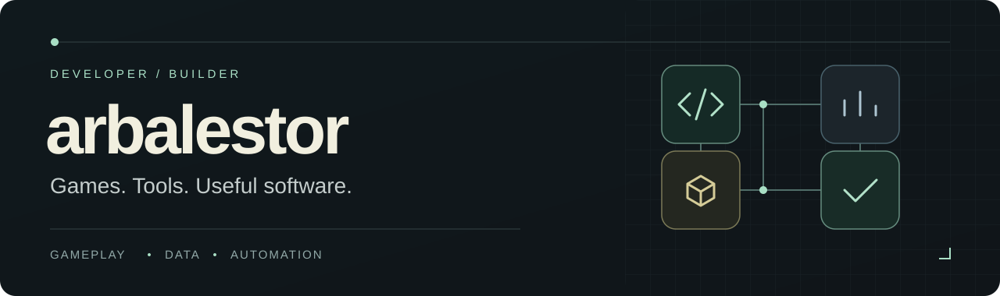

  

  <a href="README.md">English</a> · <strong>Español</strong>

Desarrollo juegos, herramientas de datos y aplicaciones prácticas. Mis proyectos abarcan sistemas de gameplay, software de escritorio, interfaces web y prototipos Android, con un interés recurrente en cómo los datos y la automatización facilitan su desarrollo y su uso.

Me importan la respuesta de los controles, las interfaces claras y los sistemas pequeños que funcionan bien juntos. Prefiero probar pronto una versión jugable o utilizable y mejorarla a partir del feedback.

### Foco actual · Desarrollo de videojuegos

Estoy desarrollando un **arena-survivor de fantasía en Godot**, trabajando en sus sistemas de gameplay y en las herramientas necesarias para probarlos y mejorarlos.

- **Gameplay:** combate, comportamiento de enemigos, progresión y mejoras.
- **Datos y telemetría:** sistemas configurables y telemetría de partidas con Supabase, teniendo en cuenta el juego sin conexión.
- **Iteración:** comprobaciones automáticas, capturas visuales y pruebas humanas para orientar los siguientes cambios.

*Un proyecto independiente en desarrollo, cuyo gameplay y presentación siguen evolucionando.*

### Selección de proyectos

Gran parte de mi trabajo está en repositorios privados. Esta selección lo presenta por tipo de proyecto y tecnologías.

| Proyecto / área | Trabajo de desarrollo | Tecnologías |
| :--- | :--- | :--- |
| **Juego cooperativo de fantasía** · en desarrollo | Sistemas de gameplay con tipado y escenarios jugables para un juego de PC. | Godot · GDScript |
| **Prototipo de tower defense / RTS** | Oleadas configurables, colocación de torres, economía, sistemas de combate y telemetría de pruebas. | Godot · GDScript · JSON · Supabase |
| **Juego arcade de navegador** | Gameplay en Canvas, interacción táctil y empaquetado de versiones. | JavaScript · HTML Canvas · CSS · esbuild |
| **Aplicación de inventario y facturación** | Stock, ventas, compras, clientes, análisis y una API REST con una PWA complementaria. | C# · .NET · WinForms · SQLite · REST |
| **Prototipo de widgets para Android** | Interfaces con Compose, persistencia local, renderizado de widgets y tareas periódicas en segundo plano. | Kotlin · Jetpack Compose · WorkManager |
| **[Fantasy MVP](https://github.com/arbalestor/fantasy-mvp-tool)** · público | Tablas de proyecciones de béisbol con métricas calculadas, filtros configurables, vistas guardadas y exportación CSV. | JavaScript · DataTables · HTML/CSS |
| **Herramientas y flujos de desarrollo** | Scripts de compilación, capturas de pruebas, automatización de QA y traspasos de proyecto reproducibles. | Python · PowerShell · Git · GitHub |

### Mis herramientas de desarrollo

**Juegos** &nbsp; `Godot` `GDScript` `JavaScript` `Canvas`

**Aplicaciones** &nbsp; `C#` `.NET` `Kotlin` `Jetpack Compose` `HTML/CSS`

**Datos y herramientas** &nbsp; `SQLite` `Supabase` `JSON` `REST APIs` `Python` `PowerShell` `Git`

### Cómo trabajo

- **Empezar con algo utilizable.** Construir una parte concreta antes de ampliar el alcance.
- **Añadir complejidad cuando aporte valor.** Usar sistemas basados en datos y automatización para resolver problemas concretos.
- **Comprobar comportamiento y experiencia.** Las pruebas automáticas cubren el comportamiento objetivo; las personas valoran la usabilidad y las sensaciones al jugar.
- **Iterar sobre el producto completo.** Gameplay, interfaz, persistencia, telemetría y herramientas contribuyen al resultado.

---

  <a href="https://github.com/arbalestor?tab=repositories">Repositorios públicos</a> · <a href="https://github.com/arbalestor/fantasy-mvp-tool">Explorar Fantasy MVP</a> · <a href="README.md">Read in English</a>

