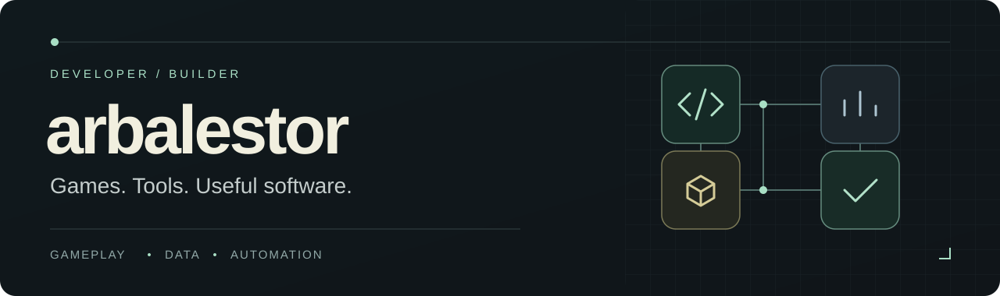

  

  <strong>English</strong> · <a href="README.es.md">Español</a>

I build games, data tools, and practical applications. My work spans gameplay systems, desktop software, web interfaces, and Android prototypes, with a recurring interest in how data and automation make them easier to develop and use.

I care about responsive interaction, clear interfaces, and small systems that work together. I prefer testing a playable or usable version early, then improving it through feedback.

### Current focus · Game development

I'm developing a **fantasy arena-survivor in Godot**, working on gameplay systems and the tools needed to test and improve them.

- **Gameplay:** combat, enemy behavior, progression, and upgrades.
- **Data & telemetry:** configurable systems and Supabase-backed run telemetry, with offline play in mind.
- **Iteration:** automated checks, visual captures, and human playtests to guide the next changes.

*An independent project in development, with gameplay and presentation still evolving.*

### Selected work

Most of my work lives in private repositories. Here is an overview by project type and technology.

| Project / area | Development work | Technologies |
| :--- | :--- | :--- |
| **Cooperative fantasy game** · in development | Typed gameplay systems and playable scenarios for a PC game. | Godot · GDScript |
| **Tower defense / RTS prototype** | Configurable waves, tower placement, economy, combat systems, and playtest telemetry. | Godot · GDScript · JSON · Supabase |
| **Browser arcade game** | Canvas gameplay, touch interaction, and release packaging. | JavaScript · HTML Canvas · CSS · esbuild |
| **Inventory & billing application** | Stock, sales, purchasing, customer records, analytics, and a REST API with a companion PWA. | C# · .NET · WinForms · SQLite · REST |
| **Android widget prototype** | Compose interfaces, local persistence, widget rendering, and scheduled background work. | Kotlin · Jetpack Compose · WorkManager |
| **[Fantasy MVP](https://github.com/arbalestor/fantasy-mvp-tool)** · public | Baseball projection tables with computed metrics, configurable filters, saved views, and CSV export. | JavaScript · DataTables · HTML/CSS |
| **Development tooling & workflows** | Build scripts, playtest captures, QA automation, and repeatable project handoffs. | Python · PowerShell · Git · GitHub |

### My development toolkit

**Games** &nbsp; `Godot` `GDScript` `JavaScript` `Canvas`

**Applications** &nbsp; `C#` `.NET` `Kotlin` `Jetpack Compose` `HTML/CSS`

**Data & tooling** &nbsp; `SQLite` `Supabase` `JSON` `REST APIs` `Python` `PowerShell` `Git`

### How I work

- **Start with something usable.** Build a focused slice before expanding the scope.
- **Keep complexity earned.** Use data-driven systems and automation where they solve a concrete problem.
- **Check behavior and experience.** Automated tests cover objective behavior; people judge usability and game feel.
- **Iterate across the whole product.** Gameplay, UI, persistence, telemetry, and tooling all contribute to the result.

---

  <a href="https://github.com/arbalestor?tab=repositories">Public repositories</a> · <a href="https://github.com/arbalestor/fantasy-mvp-tool">Explore Fantasy MVP</a> · <a href="README.es.md">Leer en español</a>

